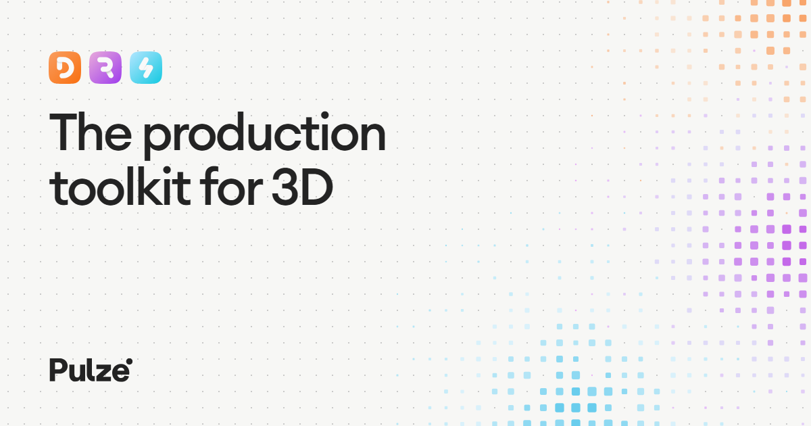

  

# Pulze

Rendering, AI and workflow tools for 3D production. Manage your render farm, create with AI and work faster in your 3D apps, from scene setup to the final image. Made by 3D artists, for 3D artists.

We started as 3D artists building tools for our own studio work. Today Pulze makes four products for visualization, VFX and animation teams.

## Products

### [RenderFlow](https://www.pulze.io/products/renderflow)
A render farm manager that runs on your own machines and scales into your own Azure or AWS account. Submit from 26 applications, including 3ds Max, Cinema 4D, Blender, Maya, Houdini, Unreal Engine, Nuke and After Effects, on Windows, Linux and macOS. Watch frames as they render, and chain renders into movies and comps.

- [Moving from Deadline](https://www.pulze.io/products/renderflow/deadline)
- [AI render wrangler](https://www.pulze.io/products/renderflow/ai): manage your farm from Claude or any MCP client
- [Pricing](https://www.pulze.io/pricing/renderflow): monitoring and management are free, with one licence per render machine

### [Project Dream](https://www.pulze.io/products/project-dream)
Image and video AI fine-tuned for visualization specialists and architects. Generate, edit, upscale and animate from your renders, with plugins for 3ds Max, Maya, Blender, Cinema 4D, Revit, Rhino, SketchUp and Photoshop, or in the browser.

- [Pricing](https://www.pulze.io/pricing/project-dream)

### [Scene Manager](https://www.pulze.io/products/scene-manager)
Scene states and batch rendering for 3ds Max. Save cameras, lights, objects and render settings as states, then render every setup in one batch.

- [Pricing](https://www.pulze.io/pricing/scene-manager): free tier, Pro and Enterprise
- [Workflow Bundle](https://www.pulze.io/pricing/workflow-bundle): Scene Manager and RenderFlow together

### [LayerWise](https://www.pulze.io/products/layerwise)
A free Photoshop plugin that builds one layered PSD from your render elements and swaps in new renders without losing your edits.

- [Download](https://account.pulze.io/products/layerwise): free with a Pulze account

## Resources

- [Documentation](https://docs.pulze.io)
- [Tutorials](https://www.pulze.io/tutorials)
- [Blog](https://www.pulze.io/blog)
- [FAQs](https://www.pulze.io/faqs)

## For developers

RenderFlow has a REST API, TypeScript and Python SDKs, a command line tool and webhooks. Everything in the interface is also available to your pipeline.

- [Getting started](https://docs.pulze.io/renderflow/developers/overview): which way to connect your code, and where to begin
- [REST API](https://docs.pulze.io/renderflow/developers/rest-api) and the [API reference](https://docs.pulze.io/renderflow/api-reference/introduction)
- [Cookbook](https://docs.pulze.io/renderflow/developers/cookbook): submit and wait, requeue failures, pull frames
- [MCP server](https://docs.pulze.io/renderflow/developers/mcp-server): connect Claude or any MCP client to your farm

## For AI assistants

Product facts and documentation in plain text:

- [pulze.io/llms.txt](https://www.pulze.io/llms.txt): products, links and how to reach the team
- [docs.pulze.io/llms.txt](https://docs.pulze.io/llms.txt): documentation index
- [docs.pulze.io/llms-full.txt](https://docs.pulze.io/llms-full.txt): full documentation

## Talk to us

- [Contact](https://www.pulze.io/contact) or support@pulze.io
- [Discord](https://discord.gg/BxtBs9aN4E): updates, announcements and support
- [YouTube](https://www.youtube.com/c/pulzeio)
- [LinkedIn](https://www.linkedin.com/company/pulze-io)
- [Instagram](https://www.instagram.com/pulzeio)
